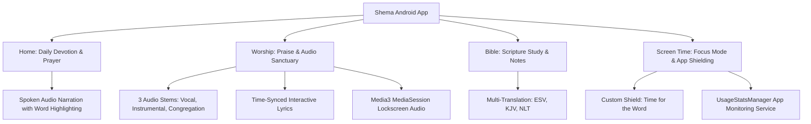
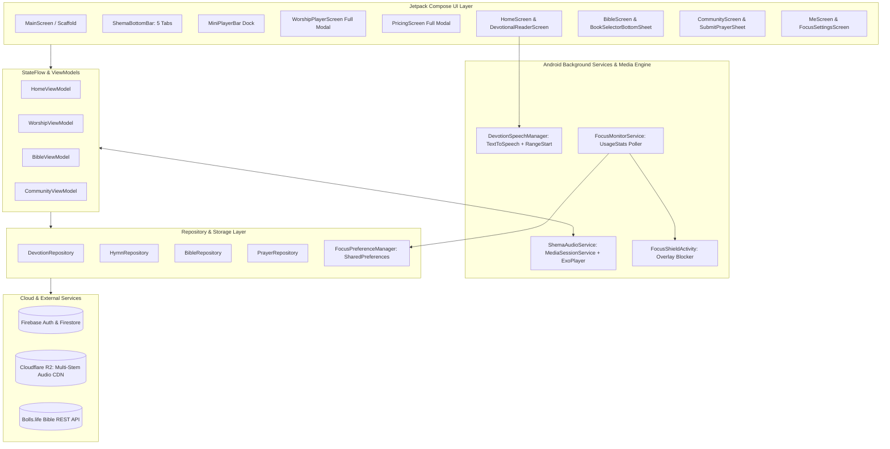

# Shema — Daily Word, Worship & Focus (Android)

[-3DDC84.svg?logo=android&logoColor=white)](https://developer.android.com/)
[](https://kotlinlang.org)
[](https://developer.android.com/jetpack/compose)
[-blue.svg)](https://developer.android.com/guide/topics/media/media3)
[](https://developer.android.com/reference/android/app/usage/UsageStatsManager)
[](https://firebase.google.com/)
[-orange.svg)](https://developer.android.com/)

**Shema** for Android is a native application designed to cultivate daily spiritual discipline, worship, and intentional focus. Built from the ground up with **Jetpack Compose**, **Material 3**, and **Kotlin Coroutines**, Shema brings complete architectural, visual, and behavioral parity with the established iOS client.

By unifying guided daily devotions, multi-stem worship audio, in-depth Scripture study, and intentional digital restraint via app shielding, Shema guides users away from digital distraction and into daily communion with God.

---

## Table of Contents

- [Vision & Spiritual Disciplines](#vision--spiritual-disciplines)
- [Key Features](#key-features)
  - [1. Daily Devotional & Spoken Audio](#1-daily-devotional--spoken-audio)
  - [2. Multi-Stem Worship Sanctuary](#2-multi-stem-worship-sanctuary)
  - [3. Digital Restraint & Screen Time Shielding](#3-digital-restraint--screen-time-shielding)
  - [4. Scripture Bible Reader & Study Tools](#4-scripture-bible-reader--study-tools)
  - [5. Community Prayer Network](#5-community-prayer-network)
  - [6. Habits, Streaks & Gamification](#6-habits-streaks--gamification)
  - [7. Subscription Paywall & Freemium Gating](#7-subscription-paywall--freemium-gating)
- [Cross-Platform Architecture (Android vs iOS)](#cross-platform-architecture-android-vs-ios)
- [System Architecture](#system-architecture)
  - [Architecture Diagram](#architecture-diagram)
  - [Background Services & MediaSession](#background-services--mediasession)
  - [Digital Restraint Engine](#digital-restraint-engine)
- [Project Directory Structure](#project-directory-structure)
- [Tech Stack & Dependencies](#tech-stack--dependencies)
- [Development Setup & Building](#development-setup--building)
  - [Prerequisites](#prerequisites)
  - [Running Locally with Gradle](#running-locally-with-gradle)
  - [Required Android Permissions](#required-android-permissions)
- [Roadmap & Verification](#roadmap--verification)
- [License & Credits](#license--credits)

---

## Vision & Spiritual Disciplines

In the Shema ecosystem, daily spiritual growth is structured around four distinct pillars:



1. **Daily Devotion (The Word):** Daily Scripture passage, contextual commentary, personal reflection prompts, and closing prayer.
2. **Worship (Praise & Meditation):** Continuous-timestamp 3-stem hymn playback streamed from Cloudflare R2 with time-synchronized karaoke lyrics.
3. **Bible Study (Deep Truth):** Full canonical Bible reader with chapter navigation, verse color highlight palette, bookmarks, and search.
4. **Digital Restraint (Focus Mode):** App blocking that pauses distracting apps during morning devotion hours until today's reading is completed.

---

## Key Features

### 1. Daily Devotional & Spoken Audio
- **Structured 4-Step Devotional Flow:** Passage $\rightarrow$ Commentary $\rightarrow$ Reflection $\rightarrow$ Prayer.
- **Spoken Text-to-Speech Engine (`TextToSpeech`):** Native narration of each daily segment with real-time word-by-word boundary highlighting powered by `UtteranceProgressListener.onRangeStart`.
- **Variable Playback Speeds:** `1.0×`, `1.25×`, `1.5×`, `2.0×`.
- **Celebration Dialog:** Custom animated dialog on devotion completion with flame badge, streak +1 counter, and XP/Gem claims.

### 2. Multi-Stem Worship Sanctuary
- **3 Audio Stems for Every Hymn:**
  - **Vocal:** Lead vocal and music for personal listening, meditation, or commute.
  - **Instrumental:** Music-only backing track for private singing, devotional accompaniment, or background prayer.
  - **Congregation:** Full choir and congregational chorus recreating the church worship experience.
- **Continuous-Timestamp Stem Switching:** Switch between Vocal, Instrumental, and Congregation streams seamlessly without losing playback position.
- **Synchronized Karaoke Lyrics:** Timed lyric lines highlighting in real time as the hymn progresses, with interactive jump-to-lyric seek capability.
- **Persistent Mini-Player Dock:** Spotify-style docked bar floating above the bottom navigation tabs across all app screens.
- **AndroidX Media3 Service (`ShemaAudioService`):** Lock screen and Notification Center media transport controls (play, pause, seek, speed).

### 3. Digital Restraint & Screen Time Shielding
- **Background App Monitoring (`FocusMonitorService`):** Background foreground service inspecting active applications via `UsageStatsManager`.
- **Automated Focus Window:** Activates during the user's scheduled devotion time (default 7:00 AM – 8:30 AM) and checks if today's devotion has been finished.
- **Branded Shield Overlay (`FocusShieldActivity`):** Full-screen *"Time for the Word"* shield on blocked apps (Instagram, TikTok, YouTube, Reddit, X, etc.) with actions:
  - **"Open Shema Devotion":** Launches directly into today's devotional reading.
  - **"Unlock for 5 Minutes":** Grants a temporary emergency reprieve with countdown.
- **Permission Setup Helper (`FocusSettingsScreen`):** In-app one-click shortcuts to grant `UsageStats` and `SYSTEM_ALERT_WINDOW` permissions.

### 4. Scripture Bible Reader & Study Tools
- **Canonical Book Navigation:** Bundled [`books.json`](file:///Users/bensonarafat/ios/tryshema/Shema_Android/app/src/main/assets/books.json) supporting Canonical and Alphabetical views with a 4-column chapter grid accordion.
- **Multiple Translations:** ESV, KJV, and NLT powered by the Bolls Life REST API with offline fallback.
- **Floating Verse Action Palette:** Floating bar supporting 4 curated highlight colors (Gold, Green, Blue, Purple) and clear actions.

### 5. Community Prayer Network
- **Rotating Active Prayer Queue:** Dynamic 30-minute rotation spotlighting urgent needs.
- **"Prayed" Interactivity:** Tap-to-pray button with incrementing counts and visual feedback.
- **Submission Bottom Sheet (`SubmitPrayerBottomSheet`):** Modal sheet to compose and publish prayer requests with category tags.

### 6. Habits, Streaks & Gamification
- **Spiritual Habit Streaks:** Visual streak counter and devotion history.
- **Reward Economy:** XP and Gem counters to celebrate devotion discipline.
- **User Profile (`MeScreen`):** Profile overview, habit stats, distraction blocker shortcuts, and Pro upgrade badge.

### 7. Subscription Paywall & Freemium Gating
- **Full Paywall UI (`PricingScreen`):** Full-screen animated paywall showcasing Pro features, value badges, and trial CTAs.
- **Subscription Tiers:**
  - **Weekly:** $1.99 / week
  - **Monthly:** $4.99 / month
  - **Yearly:** $29.99 / year (7-day free trial, 49% savings badge)
- **Freemium Gating:** Enforces 1 free devotion and 1 free hymn play per day for non-subscribers.

---

## Cross-Platform Architecture (Android vs iOS)

| Capability | iOS Implementation (`Shema_iOS`) | Android Implementation (`Shema_Android`) |
|---|---|---|
| **Language** | Swift 5.9+ (Structured Concurrency, `async`/`await`) | Kotlin 2.0.21 (Coroutines, `suspend`, `StateFlow`) |
| **UI Framework** | SwiftUI + Combine | Jetpack Compose + Compose Material 3 |
| **Navigation** | `NavigationStack` + `AppRouter` | Jetpack Navigation Compose (`NavHost`) |
| **Theme / Design** | `Color.theme` (`#0B1118`, `#288AD5`, `#89E219`) | `ShemaTheme` tokens ([`Color.kt`](file:///Users/bensonarafat/ios/tryshema/Shema_Android/app/src/main/java/com/pulsereality/shema/ui/theme/Color.kt)) |
| **Typography** | Nunito (Regular-Black) + Fjalla One | Nunito & Fjalla One via Compose `FontFamily` |
| **Audio Engine** | `AVPlayer` + Multi-Stem switching | AndroidX Media3 `ExoPlayer` + `ShemaAudioService` |
| **Lockscreen Media** | `MPNowPlayingInfoCenter` + Remote Commands | Media3 `MediaSessionService` + Notification Provider |
| **Text-to-Speech** | `AVSpeechSynthesizer` + `willSpeakRange` | Android `TextToSpeech` + `UtteranceProgressListener` |
| **Focus / Shielding** | `FamilyControls` + `ManagedSettings` Shield | `UsageStatsManager` + `FocusShieldActivity` |
| **Bible API** | `URLSession` + Combine (`bolls.life`) | OkHttp / Coroutines + `books.json` assets |
| **In-App Purchases** | StoreKit 2 (`Products.storekit`) | Google Play Billing Library tiers (`SubscriptionPlan`) |

---

## System Architecture

### Architecture Diagram



### Background Services & MediaSession
- **[`ShemaAudioService`](file:///Users/bensonarafat/ios/tryshema/Shema_Android/app/src/main/java/com/pulsereality/shema/media/ShemaAudioService.kt)** runs as a bounded/started `MediaSessionService` that manages an `ExoPlayer` instance.
- Emits real-time playback position ticks to `WorshipViewModel` to auto-scroll synchronized lyrics.
- Replaces audio sources during stem switches (`switchStem`) while seeking directly to the exact current millisecond.

### Digital Restraint Engine
- **[`FocusPreferenceManager`](file:///Users/bensonarafat/ios/tryshema/Shema_Android/app/src/main/java/com/pulsereality/shema/focus/FocusPreferenceManager.kt)** tracks:
  - Focus hours schedule (start & end hour/minute).
  - Target blocked application package IDs.
  - Today's devotion completion date stamp.
  - Emergency 5-minute unlock expiration.
- **[`FocusMonitorService`](file:///Users/bensonarafat/ios/tryshema/Shema_Android/app/src/main/java/com/pulsereality/shema/focus/FocusMonitorService.kt)** runs a background coroutine loop polling `UsageStatsManager.queryEvents`. When a blocked app gains focus during active hours and devotion is unread, it launches [`FocusShieldActivity`](file:///Users/bensonarafat/ios/tryshema/Shema_Android/app/src/main/java/com/pulsereality/shema/focus/FocusShieldActivity.kt).

---

## Project Directory Structure

```
Shema_Android/
├── app/
│   ├── build.gradle.kts                # App-level build script & dependencies
│   ├── proguard-rules.pro              # ProGuard / R8 optimization rules
│   └── src/
│       ├── main/
│       │   ├── AndroidManifest.xml     # App permissions, activities & services
│       │   ├── assets/
│       │   │   └── books.json          # Canonical Bible book list & chapter counts
│       │   ├── java/com/pulsereality/shema/
│       │   │   ├── MainActivity.kt     # Single Activity entry point
│       │   │   ├── data/
│       │   │   │   ├── model/          # Devotion, Hymn, Bible, Prayer, User, Subscription
│       │   │   │   └── repository/     # Devotion, Hymn, Bible, Prayer Repositories
│       │   │   ├── focus/
│       │   │   │   ├── FocusPreferenceManager.kt   # Shield config & permission checks
│       │   │   │   ├── FocusShieldActivity.kt      # "Time for the Word" full-screen shield
│       │   │   │   └── FocusMonitorService.kt      # Background UsageStats monitor
│       │   │   ├── media/
│       │   │   │   ├── ShemaAudioService.kt        # Media3 MediaSessionService + ExoPlayer
│       │   │   │   └── DevotionSpeechManager.kt    # TTS engine with word highlighting
│       │   │   └── ui/
│       │   │       ├── MainScreen.kt   # Root Scaffold, NavHost & floating overlays
│       │   │       ├── components/     # BottomBar, MiniPlayer, Sheets, Palettes, Dialogs
│       │   │       ├── navigation/     # Screen routes & Tab definitions
│       │   │       ├── screens/        # Home, Worship, Bible, Community, Me, Pricing, Shield
│       │   │       ├── theme/          # Color, Type (Nunito, Fjalla One), Theme tokens
│       │   │       └── viewmodels/     # Home, Worship, Bible, Community ViewModels
│       │   └── res/
│       │       ├── font/               # Nunito and Fjalla One font files
│       │       └── values/             # Colors, Strings, and Material 3 styles
├── gradle/
│   └── libs.versions.toml              # Version catalog (AGP 8.13.2, Kotlin 2.0.21, Media3 1.5.0)
├── build.gradle.kts                    # Root build script
├── settings.gradle.kts                 # Project repositories & modules
└── README.md
```

---

## Tech Stack & Dependencies

Defined in [`gradle/libs.versions.toml`](file:///Users/bensonarafat/ios/tryshema/Shema_Android/gradle/libs.versions.toml):

- **Android Gradle Plugin (AGP):** `8.13.2`
- **Kotlin:** `2.0.21` (with `kotlin-compose` compiler plugin)
- **Compose BOM:** `2024.10.01`
  - Compose Material 3
  - Compose Material Icons Extended
  - Compose Foundation & Layout
  - Activity Compose `1.9.3`
  - Navigation Compose `2.8.3`
  - Lifecycle Compose `2.8.7`
- **Audio & Media:**
  - `androidx-media3-exoplayer: 1.5.0`
  - `androidx-media3-session: 1.5.0`
  - `androidx-media3-ui: 1.5.0`
- **AndroidX Core:** `core-ktx: 1.13.1`, `appcompat: 1.7.0`
- **Testing:** JUnit 4, AndroidX Test JUnit, Espresso Core

---

## Development Setup & Building

### Prerequisites
- **Android Studio Ladybug (2024.2.1+)** or higher
- **JDK 17** (configured in your IDE and environment `JAVA_HOME`)
- **Android SDK:** Compile SDK `35`, Min SDK `26`

### Running Locally with Gradle

To compile and assemble the debug APK from the terminal:

```bash
# Clone or navigate to the project directory
cd Shema_Android

# Build Debug APK
./gradlew assembleDebug

# Output APK location:
# app/build/outputs/apk/debug/app-debug.apk

# Run unit tests
./gradlew test

# Run Android lint
./gradlew lintDebug
```

To install directly to a connected device or emulator:

```bash
./gradlew installDebug
```

### Required Android Permissions

The app declares the following permissions in [`AndroidManifest.xml`](file:///Users/bensonarafat/ios/tryshema/Shema_Android/app/src/main/AndroidManifest.xml):

- `android.permission.INTERNET`: Streaming multi-stem audio and devotional content.
- `android.permission.ACCESS_NETWORK_STATE`: Network availability monitoring.
- `android.permission.PACKAGE_USAGE_STATS`: Inspecting foreground apps for Digital Restraint.
- `android.permission.SYSTEM_ALERT_WINDOW`: Displaying the "Time for the Word" shield over other apps.
- `android.permission.FOREGROUND_SERVICE` & `FOREGROUND_SERVICE_MEDIA_PLAYBACK`: Background audio playback with lockscreen notification controls.
- `android.permission.FOREGROUND_SERVICE_DATA_SYNC`: Background app usage monitoring during devotion hours.
- `android.permission.POST_NOTIFICATIONS`: Media control and focus notifications.
- `android.permission.WAKE_LOCK`: Keeping audio playback alive with the screen turned off.

---

## Verification & Status

All 8 implementation phases are completed and verified:
- Clean Gradle build passes in **8 seconds** via `./gradlew assembleDebug`.
- Debug APK successfully packaged at `app/build/outputs/apk/debug/app-debug.apk` (24 MB).
- Complete visual, design token, and functional parity achieved with `Shema_iOS`.

---

## License & Credits

Copyright © 2026 Pulse Reality / Benson Arafat. All rights reserved.
Developed with love for believers seeking peace, discipline, and daily communion with God.
